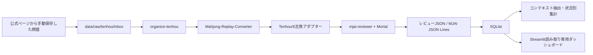

# Mahjong Analyzer 技術ノート

## 位置づけ

現行実装を運用・保守するための技術的な判断と制約をまとめます。Phase 0の詳細は [`technical-research.md`](technical-research.md)、要件の正本は [`CODEX_SPEC.md`](CODEX_SPEC.md) です。

現時点では、ローカル保存した天鳳牌譜またはTenhou/6 JSONをmjai-reviewer・Mortalで評価し、SQLiteへ保存し、状況別集計とStreamlitの局面復習画面で確認できます。雀魂・天鳳への自動ログインや自動ダウンロードは実装していません。

## システム構成

主な責務は次のとおりです。

- `cli.py`: CLIの入口と引数検証。
- `runner.py`: Tenhou/6検証、レビュー実行、中間ファイル管理。
- `tenhou.py` / `workflow.py`: `.mjlog`変換、重複判定、inbox/processed/failed整理。
- `compat.py`: 確認済みの暗槓表記だけを解析用コピーへ補正。
- `importer.py` / `schema.py`: JSON正規化、トランザクション登録、SQLiteスキーマ。
- `context.py` / `analytics.py`: 局面復元、状況別集計、条件検索。
- `review.py` / `table_view.py`: 判断時点の公開情報と卓面ViewModel。
- `dashboard/data.py`: SQLiteを`mode=ro`・`query_only`で開く読み取り専用層。
- `dashboard/table_renderer.py`: SQLiteへアクセスせず卓面HTMLを生成。
- `app.py`: Streamlit表示層。

## 技術スタックと確認済み条件

`pyproject.toml`で確認できる条件です。

| 項目 | 条件 |
|---|---|
| Python | `>=3.12,<3.13` |
| パッケージ | `mahjong-analyzer` 0.1.0 |
| テスト | pytest `>=8.3,<9`（`dev` extra） |
| ダッシュボード | Streamlit `>=1.39,<2`（`dashboard` extra） |
| DB | Python標準ライブラリのSQLite |

Mortal、mjai-reviewer、Converterの実機バージョン、ライセンス、モデル条件は [`technical-research.md`](technical-research.md)を参照してください。モデル重みはGitへ同梱せず、配布条件を個別に確認したものだけをローカル設定します。

## データと識別

- 入力`.mjlog`、Tenhou/6 JSON、レビューJSON、MJAI JSON Lines、SQLiteはローカルデータです。
- ゲームID、解決済み座席、レビュー条件、モデル・温度・reviewer条件を組み合わせて同一解析を判定します。
- Tenhou取り込みでは元`.mjlog`のSHA-256も補助識別子として保持します。
- 解析失敗時はSQLite登録前に停止し、入力原本と理由サイドカーを保持します。
- `processed/`は原本保管場所であり、正式な解析状態はSQLiteで管理します。
- 別モデル・別温度・別reviewer条件は別レビューとして扱います。

## 指標の扱い

- AI一致率は`total_matches / total_reviewed`です。
- 低推奨行動率は、比較可能な`actual_probability`に対する`< 0.05`の割合です。閾値はCLIで変更できます。
- Mortal Ratingはレビュー単位で保持し、複数対局の単純平均は作りません。
- これらはMortalのモデル分布に基づく評価であり、実際の点数損失、客観的な悪手率、絶対的な最善手を意味しません。
- モデル、GRP、reviewer、温度、ルールが違う結果は無条件に比較しません。

## UIと素材

Streamlitは保存済みレビューとMJAIイベントから判断時点の公開情報だけを表示します。非公開の他家手牌や未公開の山牌は表示しません。手牌・河・副露・ドラ・点数・Mortal候補に判断後の情報を混ぜない方針です。

牌画像はローカルの麻雀王国素材を使用しています。通常牌と派生赤5の条件・出典・再生成方法は [`assets/third_party/mj_king/README.md`](../assets/third_party/mj_king/README.md)に記録しています。外部CDNや画像ごとのネットワークアクセスはありません。

## 既知の制約・未解決事項

- Apple SiliconでのMortal/mjai-reviewer実機検証は技術調査に記録された条件付き結果です。CPU実行、MPS可否、モデルとGRPの配布条件は環境ごとに確認が必要です。
- Converter v0.2.3の暗槓表記にはmjai-reviewer 1.5.10との既知の差があり、解析用コピーだけを補正します。未知の表記は推測補正しません。
- 天鳳固有の同点順位や特殊ルールは、復元できない場合に不明として扱います。
- Playwrightは必須依存にしていません。未導入環境ではブラウザ衝突検査は任意テストとしてスキップされます。
- 複数対局のRatingを統合する妥当な方法は未確定です。
- 個人牌譜を公開テストfixtureにしません。

## 保守時の原則

1. 既存のMortal・mjai-reviewer機能を優先し、独自の評価ロジックを増やさない。
2. 元牌譜とConverter原出力を変更せず、補正は解析用コピーへ限定する。
3. SQLiteへの書き込みはimport/workflowに限定し、ダッシュボードは読み取り専用にする。
4. 不明な座席、イベント、牌種、条件は推測せず、状態理由を保存・表示する。
5. 個人データ、認証情報、モデル重み、ローカル設定をCommitしない。
